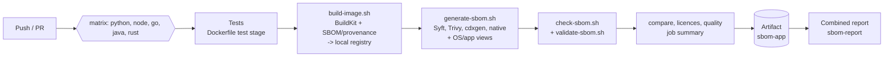

# DevSecOps SBOM PoC

A proof of concept showing a security pipeline built around **five small, deliberately vulnerable apps** (Python, Node.js, Go, Java, Rust). It starts with SBOM generation and adds one class of security check per iteration (SCA, secrets, SAST, image scanning, signing, DAST…).

> ⚠️ **Every app in `apps/` is intentionally insecure** (injection flaws, SSRF, unsafe deserialization, weak crypto, old dependencies with known CVEs). Run them on localhost only. Never deploy them.

- [`docs/SECURITY-CHECKS.md`](docs/SECURITY-CHECKS.md): catalogue of security check types, tool options, and what this PoC covers
- `sbom/SBOM-REPORT.md`: generated by `make report`, and by CI as the `sbom-report` artifact (generators, validation, licences, quality for every app; stamped with commit, tool versions and image digests). Not committed, so it can't drift from the code.

## Iteration log

| # | Iteration | Status |
|---|---|---|
| 1 | Apps + SBOM generation (Syft, Trivy, cdxgen, native, BuildKit) + validation + licences + quality | ✅ |
| 2 | SBOM vulnerability scan (Grype + Trivy) + gate on critical/high | proposed |
| 3 | Secrets scanning (Gitleaks) | proposed |
| 4 | SAST (Semgrep) | proposed |
| 5 | Dockerfile + CI hardening (Hadolint, zizmor, actionlint) | proposed |
| 6 | Container image scan | proposed |
| 7 | Signing + SBOM attestation + provenance (Cosign) | proposed |
| 8 | DAST (ZAP baseline) | proposed |
| 9 | Dependency-Track, VEX, licences, … | proposed |

## Quick start

Requirements: Docker (with buildx), `make`, `jq`.

```bash
make help               # all targets
make apps               # list apps and their local ports
make test APP=go        # run one app's tests
make run  APP=node      # start one app on 127.0.0.1:<port>
make build APP=java     # BuildKit build + SBOM/provenance attestations, via a local registry
make sbom APP=java      # build it, generate all SBOMs into sbom/java/, check + validate them
make sbom-compare APP=java
make validate APP=java  # schema validation (cyclonedx-cli, pyspdxtools)
make licenses APP=java  # licence policy check (grant)
make quality APP=java   # SBOM quality scores (sbomqs)
make summary APP=java   # all of the above into sbom/java/reports/summary.md

make test-all           # every app
make -j sbom-all        # all apps, in parallel
make report             # combine summaries into sbom/SBOM-REPORT.md
make clean              # stop apps, delete sbom/
make infra-down         # remove the local registry + BuildKit builder
```

## The apps

| App | Stack | Runtime image | What's interesting for SBOMs | Port |
|---|---|---|---|---|
| [`python`](apps/python) | Flask 2.0.3, gunicorn | `python:3.12-slim` (Debian) | `requirements.txt` with every transitive dep pinned | 8001 |
| [`node`](apps/node) | Express 4.17.1 | `node:24-slim` (Debian) | `package-lock.json`: 4 direct deps become 214 installed packages; dev vs prod deps | 8002 |
| [`go`](apps/go) | `net/http` | distroless `static` (no shell) | Static binary: tools read the module list **embedded in the binary** | 8003 |
| [`java`](apps/java) | Spring Boot 2.6.1, Log4j 2.14.1 | `eclipse-temurin:17-jre` (Ubuntu) | Fat JAR with **nested JARs**; `pom.xml` needs Maven to resolve | 8004 |
| [`rust`](apps/rust) | tiny_http | distroless `cc` (no shell) | Binary built with **`cargo auditable`**, which embeds the crate list (without it, the binary is opaque to SBOM tools) | 8005 |

Each planted flaw is tagged `VULN:` in the code. Highlights: Log4Shell (`java`), PyYAML `yaml.load` (`python`), lodash prototype pollution and `eval` (`node`), user-controlled regex on regex 1.5.4 (`rust`), dgrijalva/jwt-go (`go`), plus command injection and SSRF in every app.

### App contract

Every app follows the same layout, so scripts, `make` and CI treat them identically:

```
apps/<app>/
  Dockerfile         stages: test (runs the tests) -> runtime (default, non-root)
                     optional: maven-repo (exports resolved deps for offline SBOM scans)
  sbom-expect.txt    package URLs every SBOM must contain (the vulnerable markers)
  sbom-reject.txt    packages that must NOT ship: dev/test deps (optional)
  sbom-expect-skip.txt  documented exceptions: "<sbom file> <purl|*> <reason>" (optional)
  .dockerignore
```

- Listens on **8080** inside the container and serves `GET /health` → `{"status":"ok"}`.
- Base images pinned by digest; every dependency pinned to an exact version.

To add an app: create `apps/<name>/` following the contract, add a port in the `Makefile` and a matrix entry in the workflow.

## SBOMs

`make build` builds the runtime image with **BuildKit**, attaches BuildKit's own SBOM and SLSA provenance as attestations, pushes it to a **local registry** (`127.0.0.1:5055`) and pulls it back. Every generator then scans that exact image, and `sbom/<app>/artifact.json` records its digest: the identity that signing (iteration 7) will need.

`make sbom` then runs **four more generators** and writes to `sbom/<app>/`:

| Generator | Source SBOM (repo) | Image SBOM (container) | Formats | How it runs |
|---|---|---|---|---|
| [Syft](https://github.com/anchore/syft) | `syft-source.*` | `syft-image.*` | CycloneDX + SPDX | pinned container |
| [Trivy](https://github.com/aquasecurity/trivy) | `trivy-source.*` | `trivy-image.*` | CycloneDX + SPDX | pinned container |
| [cdxgen](https://github.com/cdxgen/cdxgen) (OWASP CycloneDX) | `cdxgen-source.cdx.json` | `cdxgen-image.cdx.json` | CycloneDX | release binary (checksum-pinned); source: mounted into the app's build image (real toolchain); image: on a `docker save` tarball |
| **Native** OWASP CycloneDX generator | `native-source.cdx.json` | – | CycloneDX | inside the app's Docker build (`sbom` stage) |
| **BuildKit** `--sbom=true` (buildkit-syft-scanner) | – | `buildkit-image.spdx.json` (+ `buildkit-provenance.json`) | SPDX 2.3 | attestation attached to the image in the registry |

**Security:** no tool gets the Docker socket. Images are scanned from a `docker save` tarball; cdxgen's image scan runs in a pinned container with `--network none`. (An earlier version mounted the socket into the vulnerable app's own build image for cdxgen: host-root-equivalent access for that image's install scripts.)

**Views:** each image SBOM also gets derived `views/<gen>-image-os.cdx.json` (deb/apk/rpm) and `-app.cdx.json` (pypi/npm/maven/…). The full image SBOM stays the source of truth (it describes the artifact and is what gets signed); the views let different policies apply: GPL is normal in OS packages but a policy question in app dependencies. Later, CVE triage can follow the same split (base-image updates vs dependency bumps).

Native generators per language, all from the OWASP CycloneDX project:

| App | Native generator | Runs on |
|---|---|---|
| python | `cyclonedx-py environment` | the installed environment (tool in a separate venv) |
| node | `@cyclonedx/cyclonedx-npm --omit dev` | npm's production dependency tree |
| go | `cyclonedx-gomod app -std -licenses` | modules compiled into the binary + Go stdlib |
| java | `cyclonedx-maven-plugin:makeBom` | Maven's resolved tree, runtime scopes only |
| rust | `cargo cyclonedx` | Cargo metadata |

Source SBOM = "what did we ask for?"; image SBOM = "what are we shipping?".

> **Why the cdxgen release binary, not the image?** The official image (`ghcr.io/cdxgen/cdxgen`) is ~16.6 GB: a full build machine (JDK, Maven, Gradle, sbt, .NET, Python, Ruby, PHP, Go, Rust, Swift…) on AlmaLinux 10, which needs an x86-64-v3 (AVX2) CPU ("Fatal glibc error: CPU does not support x86-64-v3"). The README recommends the standalone binaries for CI: `cdxgen-linux-amd64` is 183 MB with Node built in. Two gotchas: it unpacks itself to `/tmp` (container `/tmp` must allow exec), and its Node needs `libatomic.so.1`, which slim images lack, so the script ships that one library next to the binary instead of changing the app images. Online licence lookup (`FETCH_LICENSE`) is off: slow, rate-limited, and the other generators already provide licences.

### Validation

`make validate APP=<app>` checks every SBOM against its specification: CycloneDX with `cyclonedx-cli validate` (JSON schema of the declared spec version), SPDX with the SPDX project's `pyspdxtools`. Part of `make sbom`: an invalid SBOM fails the build (known generator bugs can be listed in `apps/<app>/sbom-invalid-ok.txt`). Both validators were confirmed to reject deliberately broken files.

Finding: **BuildKit's SBOM attestation is not valid SPDX 2.3** in any app. Its scanner writes only SHA256 checksums for files, and SPDX 2.3 requires a SHA1 checksum for every file (thousands of errors per image). Recorded in each `sbom-invalid-ok.txt` and shown as ⚠️, not hidden.

### Licences

`make licenses APP=<app>` checks the licences of the app's **dependencies** (source SBOMs, the native SBOM and the image **app** views) against [`policy/licenses.yaml`](policy/licenses.yaml) with [grant](https://github.com/anchore/grant). Permissive licences, MPL-2.0 and EPL are allowed; everything else is a violation. OS packages are not checked. Report-only for now (`LICENSE_GATE=1` fails on a violation in the native SBOM).

Before grant runs, licences are **normalised** (an earlier version produced mostly false results):
- Several licence entries on one component mean a **choice**, so they're joined into one SPDX expression with `OR` (grant then evaluates it correctly: `EPL-2.0 OR GPL-2.0…` passes).
- Unambiguous Python classifiers are mapped (`MIT License` → `MIT`); ambiguous ones (`BSD License`: which BSD?) stay unknown. Leftover classifier text is dropped when an SPDX ID exists.
- The app itself and the Go standard library are ignored; entries without a version (Trivy lists `requirements.txt` itself) are dropped.
- Results are split into **violation** (a recognised licence the policy doesn't allow), **unknown** (no licence, or not machine-readable like `BSD-like`) and **ignored**, so "no data" no longer looks like a violation.

Findings:
- **python:** one real violation, `chardet` (**LGPL**), found by every generator that has licence data. cdxgen and Trivy source SBOMs have no Python licences (⚠️ incomplete data).
- **java:** the native SBOM passes. cdxgen and Trivy both get `jakarta.annotation-api` wrong: cdxgen writes an invalid expression that drops EPL-2.0 (`GPL-2.0-or-later OR Classpath-exception-2.0`), Trivy uses a non-SPDX exception name (`classpath-exception`) so the expression doesn't parse. **Generator licence data needs checking, not just trusting.**
- **rust:** only the native generator records licences; the others have none.
- **node:** dependencies pass, but the **image** app view has 2 violations: `npm` itself (Artistic-2.0) and its bundled `spdx-exceptions` (CC-BY-3.0). They come from the Node **base image**, not the app: the production image ships a package manager it doesn't need. Fix options: remove npm from the runtime image / use a distroless Node image, or allow Artistic-2.0 in the policy. (Open decision.)
- **go:** passes; image views have no licences for Go modules (⚠️ incomplete data).

### Quality

`make quality APP=<app>` scores every SBOM with [sbomqs](https://github.com/interlynk-io/sbomqs) **per format** (CycloneDX and SPDX encode the same data differently; ranking them together mostly measured the format). CycloneDX is scored without per-file entries (Syft lists ~950 files for go, which sbomqs penalised as "components without a version"). Profiles: Interlynk, **NTIA/CISA 2026** minimum elements, **BSI TR-03183-2 v2.1**, CISA **FSCT** 3rd edition. Each row lists the CISA 2026 elements the SBOM is missing; common gaps: no signature (iteration 7), no author / generation context, no component hashes (Syft, Trivy source, cdxgen image).

### Checks

`make sbom` fails if: a generator's file is missing; the image has no digest or BuildKit attestation; any CycloneDX SBOM lacks a marker from `sbom-expect.txt` (unless excused in `sbom-expect-skip.txt` with a reason: e.g. Syft has no transitive Maven deps, cdxgen can't read `cargo auditable`); a **dev/test dependency** from `sbom-reject.txt` appears in what ships (image SBOMs, app views, native SBOM); an image SBOM has no OS packages; or an SBOM fails schema validation.

### Reports

- `make summary APP=<app>` → `sbom/<app>/reports/summary.md` (comparison, validation, licences, quality)
- `make report` → `sbom/SBOM-REPORT.md` (all apps), headed by commit, tool versions and image digests. CI publishes it as the `sbom-report` artifact.

### What the generators disagree on

The comparison (`make sbom-compare`) normalises representation differences first, then compares **runtime dependencies**:

| Normalised (same package, different spelling) | Not compared (counted in their own rows) |
|---|---|
| Debian epochs: `1:2.41`, `1%3a2.41`, `?epoch=1` | Dev/test dependencies: cdxgen lists them with `scope: optional` (node: 107, java: 28); its `required` set matches native exactly |
| `+` vs `%2b` (Go `+incompatible`, Debian `+deb13u1`) | Debian **source** packages: cdxgen adds `glibc`, `openssl`… (`?arch=source`) next to the binary packages `libc6`, `libssl3t64` |
| Go: `v1.27.4` vs `1.27.4`, `std@go1.27.4` vs `stdlib@1.27.4` | The app itself (`poc-java`, `poc-rust`, the Go module) |
| PyPI names per PEP 503 (`_` / `.` = `-`) | |

Agreement after that (packages found by **every** generator):

| App | Source | Image | Real differences that remain |
|---|---|---|---|
| python | 14 / 16 | **102 / 102** | Native scans the installed environment: no `pytest` (dev), but lists `pip` |
| node | **67 / 67** | 299 / 300 | cdxgen also detects a `brotli` binary in the image |
| go | 3 / 4 | 9 / 10 | Go stdlib: only native lists it in source (`-std`); cdxgen doesn't read it from the binary |
| java | 2 / 34 | 179 / 181 | **Syft lists only the 4 direct deps** from `pom.xml`; cdxgen misses a Go binary's stdlib in the JDK image |
| rust | 19 / 23 | 14 / 33 | Lockfile tools list Windows-only `winapi*` crates, native (`cargo metadata` for Linux) doesn't; **cdxgen doesn't read `cargo auditable` data** from the binary |

Other per-generator traits:

| | Syft | Trivy | cdxgen | Native |
|---|---|---|---|---|
| Strengths | CPEs, supplier metadata, licences via `--enrich`, catalogues GitHub Actions | Full Maven tree from `pom.xml`, package hashes, small SBOMs | Runs the real toolchain, marks dev/test scope, finds extra binaries | Package manager's own resolution, licences, runtime scope only |
| Weak spots | Java transitive deps; large SBOMs (every file listed) | No licences for Python source | Rust binaries, Go stdlib in binaries; huge image | Only source/build view; Python licences as classifier text |

### Speed

| Change | Effect |
|---|---|
| cdxgen release binary instead of building a tool image | No image build per job; the first CI run **hung 10+ min in every job** on `docker build --output type=local` exporting that image |
| No `docker build --output type=local` at all | Stages are exported with `docker create` + `docker cp` (native SBOMs, Java's Maven repo) |
| Every tool call goes through `step`: 10-min timeout, own log in `sbom/.cache/<app>/`, duration printed | A hang fails fast and names itself; logs are uploaded with the CI artifacts |
| Persistent Trivy cache (+ `actions/cache` in CI) | Trivy's Java DB is downloaded once, not per scan (java: ~190s per scan saved) |
| cdxgen binary cached (`actions/cache`, keyed by version) | 183 MB downloaded once |
| Syft `--enrich` only for source scans | Images already carry licences (node: 55s saved) |
| Rust: prebuilt, checksum-verified `cargo-auditable` / `cargo-cyclonedx` (`ADD --checksum`) instead of `cargo install` | No compiling the tools on every CI run (rust was the slowest job: 196s) |
| Offline Maven repo for Java (`maven-repo` stage) | No Maven Central rate limits (HTTP 429) |
| `make -j sbom-all` | Apps in parallel (separate caches per app) |

Tested and **not** used: `trivy convert` (one scan instead of two, but drops package hashes), Syft `--scope all-layers` (no difference), Syft transitive Maven resolution (over-reports).

## Pipeline



- CI ([`.github/workflows/sbom.yml`](.github/workflows/sbom.yml)) runs **the same `make` targets** as local runs; tools run as containers pinned by digest.
- Actions pinned by commit SHA; read-only token; runner pinned to `ubuntu-26.04` (hosted runner images can't be pinned by digest).
- Every tool call has a timeout and its own log (uploaded with the artifacts).

## Layout

```
apps/<app>/              the five vulnerable apps (see App contract)
scripts/
  build-image.sh         BuildKit build + SBOM/provenance attestations, local registry, digest
  generate-sbom.sh       Syft, Trivy, cdxgen, native -> sbom/<app>/
  make-views.sh          OS / app views of each image SBOM
  check-sbom.sh          markers, reject list, identity, OS packages
  validate-sbom.sh       schema validation (cyclonedx-cli, pyspdxtools)
  compare-sbom.sh        generator comparison (Markdown)
  check-licenses.sh      licence normalisation + policy (grant)
  score-sbom.sh          SBOM quality per format (sbomqs)
  report-header.sh       report stamp: commit, tool versions, image digests
policy/licenses.yaml     licence allow-list
Makefile                 local entry point (APP=<app>, *-all targets)
.github/workflows/       CI (matrix per app)
docs/                    security-checks catalogue
sbom/                    generated output (git-ignored)
```
