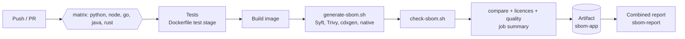

# DevSecOps SBOM PoC

A proof of concept showing a security pipeline built around **five small, deliberately vulnerable apps** (Python, Node.js, Go, Java, Rust). It starts with SBOM generation and adds one class of security check per iteration (SCA, secrets, SAST, image scanning, signing, DAST…).

> ⚠️ **Every app in `apps/` is intentionally insecure** (injection flaws, SSRF, unsafe deserialization, weak crypto, old dependencies with known CVEs). Run them on localhost only. Never deploy them.

- [`docs/SECURITY-CHECKS.md`](docs/SECURITY-CHECKS.md): catalogue of security check types, tool options, and what this PoC covers
- `docs/SBOM-REPORT.md`: generated by `make report` / the CI `sbom-report` artifact (generators, licences, quality for every app)

## Iteration log

| # | Iteration | Status |
|---|---|---|
| 1 | Apps + SBOM generation (Syft, Trivy, cdxgen, native) + licences + quality | ✅ |
| 2 | SBOM vulnerability scan (Grype + Trivy) + gate on critical/high | proposed |
| 3 | Secrets scanning (Gitleaks) | proposed |
| 4 | SAST (Semgrep) | proposed |
| 5 | Dockerfile + CI hardening (Hadolint, zizmor, actionlint) | proposed |
| 6 | Container image scan | proposed |
| 7 | Signing + SBOM attestation + provenance (Cosign) | proposed |
| 8 | DAST (ZAP baseline) | proposed |
| 9 | Dependency-Track, VEX, licences, … | proposed |

## Quick start

Requirements: Docker (with buildx), `make`, `jq`.

```bash
make help               # all targets
make apps               # list apps and their local ports
make test APP=go        # run one app's tests
make run  APP=node      # start one app on 127.0.0.1:<port>
make sbom APP=java      # build it, generate all SBOMs into sbom/java/, check them
make sbom-compare APP=java
make licenses APP=java  # licence policy check (grant)
make quality APP=java   # SBOM quality scores (sbomqs)
make summary APP=java   # all three into sbom/java/reports/summary.md

make test-all           # every app
make -j sbom-all        # all apps, in parallel
make report             # combine summaries into docs/SBOM-REPORT.md
make clean              # stop apps, delete sbom/
```

## The apps

| App | Stack | Runtime image | What's interesting for SBOMs | Port |
|---|---|---|---|---|
| [`python`](apps/python) | Flask 2.0.3, gunicorn | `python:3.12-slim` (Debian) | `requirements.txt` with every transitive dep pinned | 8001 |
| [`node`](apps/node) | Express 4.17.1 | `node:24-slim` (Debian) | `package-lock.json`: 4 direct deps become 214 installed packages; dev vs prod deps | 8002 |
| [`go`](apps/go) | `net/http` | distroless `static` (no shell) | Static binary: tools read the module list **embedded in the binary** | 8003 |
| [`java`](apps/java) | Spring Boot 2.6.1, Log4j 2.14.1 | `eclipse-temurin:17-jre` (Ubuntu) | Fat JAR with **nested JARs**; `pom.xml` needs Maven to resolve | 8004 |
| [`rust`](apps/rust) | tiny_http | distroless `cc` (no shell) | Binary built with **`cargo auditable`**, which embeds the crate list (without it, the binary is opaque to SBOM tools) | 8005 |

Each planted flaw is tagged `VULN:` in the code. Highlights: Log4Shell (`java`), PyYAML `yaml.load` (`python`), lodash prototype pollution and `eval` (`node`), user-controlled regex on regex 1.5.4 (`rust`), dgrijalva/jwt-go (`go`), plus command injection and SSRF in every app.

### App contract

Every app follows the same layout, so scripts, `make` and CI treat them identically:

```
apps/<app>/
  Dockerfile         stages: test (runs the tests) -> runtime (default, non-root)
                     optional: maven-repo (exports resolved deps for offline SBOM scans)
  sbom-expect.txt    package URLs every SBOM must contain (the vulnerable markers)
  .dockerignore
```

- Listens on **8080** inside the container and serves `GET /health` → `{"status":"ok"}`.
- Base images pinned by digest; every dependency pinned to an exact version.

To add an app: create `apps/<name>/` following the contract, add a port in the `Makefile` and a matrix entry in the workflow.

## SBOMs

For every app, `make sbom` runs **four generators** and writes to `sbom/<app>/`:

| Generator | Source SBOM (repo) | Image SBOM (container) | Formats | How it runs |
|---|---|---|---|---|
| [Syft](https://github.com/anchore/syft) | `syft-source.*` | `syft-image.*` | CycloneDX + SPDX | pinned container |
| [Trivy](https://github.com/aquasecurity/trivy) | `trivy-source.*` | `trivy-image.*` | CycloneDX + SPDX | pinned container |
| [cdxgen](https://github.com/cdxgen/cdxgen) (OWASP CycloneDX) | `cdxgen-source.cdx.json` | `cdxgen-image.cdx.json` | CycloneDX | source: inside the app's build image (real toolchain); image: [`tools/cdxgen`](tools/cdxgen) |
| **Native** OWASP CycloneDX generator | `native-source.cdx.json` | – | CycloneDX | inside the app's Docker build (`sbom` stage) |

Native generators per language, all from the OWASP CycloneDX project:

| App | Native generator | Runs on |
|---|---|---|
| python | `cyclonedx-py environment` | the installed environment (tool in a separate venv) |
| node | `@cyclonedx/cyclonedx-npm --omit dev` | npm's production dependency tree |
| go | `cyclonedx-gomod app -std -licenses` | modules compiled into the binary + Go stdlib |
| java | `cyclonedx-maven-plugin:makeBom` | Maven's resolved tree, runtime scopes only |
| rust | `cargo cyclonedx` | Cargo metadata |

Source SBOM = "what did we ask for?"; image SBOM = "what are we shipping?".

> **cdxgen and older CPUs:** the official image (`ghcr.io/cdxgen/cdxgen`) is ~16.6 GB and needs an x86-64-v3 (AVX2) CPU ("Fatal glibc error: CPU does not support x86-64-v3"). [`tools/cdxgen`](tools/cdxgen/Dockerfile) packages the npm release (`@cdxgen/cdxgen`, ~1 GB) instead, which runs anywhere Node 24 runs.

### Licences

`make licenses APP=<app>` checks the **dependency** SBOMs (source + native) against [`policy/licenses.yaml`](policy/licenses.yaml) with [grant](https://github.com/anchore/grant): permissive licences and MPL-2.0 allowed; GPL/LGPL/AGPL, unknown, and missing licences fail. Image SBOMs are excluded: OS packages (glibc, coreutils…) are GPL by nature and need a separate policy. Report-only for now (`LICENSE_GATE=1` makes it fail).

First findings (Python): `chardet` is **LGPL** (a real violation); the native Python SBOM records old-style classifiers (`License :: OSI Approved :: BSD License`) instead of SPDX IDs, so a policy can't check them; Trivy's Python source SBOM has no licences at all.

### Quality

`make quality APP=<app>` scores every SBOM 0–10 with [sbomqs](https://github.com/interlynk-io/sbomqs), including the NTIA minimum-elements and BSI TR-03183-2 profiles, and lists each SBOM's biggest gaps.

### Reports

- `make summary APP=<app>` → `sbom/<app>/reports/summary.md` (generator comparison + licences + quality)
- `make report` → `docs/SBOM-REPORT.md` (all apps). CI builds it as the `sbom-report` artifact.

### Earlier Syft vs Trivy findings

| Finding | Detail |
|---|---|
| **Image SBOMs agree** | Same packages in every image once version formats are normalised |
| **Java source: Trivy wins** | Trivy resolves the full Maven tree (34 packages); Syft lists only the 4 direct deps (its transitive option over-reported 262) |
| **Licences: Syft wins** | With `--enrich`, Syft looks licences up online for Python/npm/Go source SBOMs |
| **Hashes: Trivy; CPEs + supplier: Syft** | |
| **Size** | Syft lists every file owned by a package: 3–6× larger SBOMs |
| **Format differences** | Debian epochs (`1:2.41` vs `?epoch=1`), Go versions (`1.27.4` vs `v1.27.4`), PyPI names (`_` vs `-`): normalised before comparing |

### Speed

| Change | Effect |
|---|---|
| Persistent per-app Trivy cache (`sbom/.cache/<app>/trivy`) | Trivy's Java DB is downloaded once, not per scan (java: ~190s per scan saved) |
| Syft `--enrich` only for source scans | Images already carry licences (node: 55s saved) |
| Offline Maven repo for Java (`maven-repo` stage) | No Maven Central rate limits (HTTP 429) |
| `make -j sbom-all` | Apps in parallel (separate caches per app) |

Tested and **not** used: `trivy convert` (one scan instead of two, but drops package hashes), Syft `--scope all-layers` (no difference), Syft transitive Maven resolution (over-reports).

## Pipeline



- CI ([`.github/workflows/sbom.yml`](.github/workflows/sbom.yml)) runs **the same `make` targets** as local runs; tools run as containers pinned by digest.
- Actions pinned by commit SHA; read-only token.

## Layout

```
apps/<app>/              the five vulnerable apps (see App contract)
scripts/
  generate-sbom.sh       Syft, Trivy, cdxgen, native -> sbom/<app>/
  check-sbom.sh          sanity checks
  compare-sbom.sh        generator comparison (Markdown)
  check-licenses.sh      licence policy (grant)
  score-sbom.sh          SBOM quality (sbomqs)
policy/licenses.yaml     licence allow-list
tools/cdxgen/            cdxgen packaged from npm
Makefile                 local entry point (APP=<app>, *-all targets)
.github/workflows/       CI (matrix per app)
docs/                    security-checks catalogue
sbom/                    generated output (git-ignored)
```
