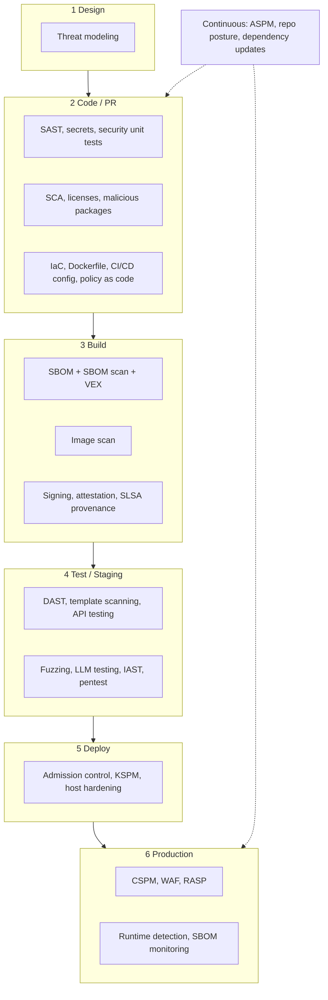
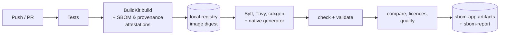
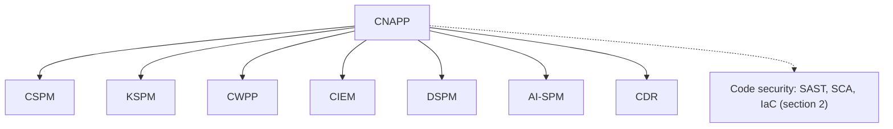

# Security Checks Catalogue

Reference list of the kinds of security checks a DevSecOps pipeline can run, from design to production, plus the cloud-platform categories (the "CNAPP alphabet soup"). The PoC repo adds them one iteration at a time.

*Last reviewed: 2026-11-16. Tool status changes fast; check before adopting.*

**Legend**
- **Tools:** plain name = open source (listed first) · `(free)` = closed-source freeware · `(free tier)` = commercial with a free plan · `(paid)` = commercial only · `(unmaintained)` / `(low activity)` = OSS with little or no recent development
- **In PoC:** ✅ done · 🟡 partly done · 🔜 planned iteration · 📄 documented only (needs a commercial tool, cloud account or a human) · ⬜ not planned yet
- **Type:** 🔍 detect (finds problems) · 🛡️ prevent (blocks or controls) · 🧾 evidence (proves something about an artifact)
- IDs are stable (`C03`, `B01`…) so references don't break when rows are added.

---

## At a glance: acronym cheat sheet

| Acronym | Meaning | In one line |
|---|---|---|
| **SAST** | Static Application Security Testing | Reads your code for vulnerabilities without running it |
| **DAST** | Dynamic Application Security Testing | Attacks the running app from outside |
| **IAST** | Interactive Application Security Testing | Agent inside the app watches it during tests |
| **RASP** | Runtime Application Self-Protection | Agent inside the app blocks attacks in production |
| **SCA** | Software Composition Analysis | Finds known-vulnerable dependencies |
| **SBOM** | Software Bill of Materials | Ingredient list of everything in your software |
| **VEX** | Vulnerability Exploitability eXchange | Statement: "this CVE does / doesn't affect us" |
| **SLSA** | Supply-chain Levels for Software Artifacts | Framework for build integrity and provenance |
| **IaC** | Infrastructure as Code | Terraform/K8s files; scanned for misconfigurations |
| **WAF** | Web Application Firewall | Filters malicious HTTP traffic |
| **ASPM** | Application Security Posture Management | One view over all AppSec findings |
| **CNAPP** | Cloud-Native Application Protection Platform | Umbrella for the cloud categories below |
| **CSPM** | Cloud Security Posture Management | Misconfigurations in live cloud accounts |
| **KSPM** | Kubernetes Security Posture Management | Misconfigurations in live clusters |
| **CWPP** | Cloud Workload Protection Platform | Protects VMs, containers, serverless |
| **CIEM** | Cloud Infrastructure Entitlement Management | Over-privileged identities |
| **DSPM** | Data Security Posture Management | Where sensitive data lives and who can reach it |
| **AI-SPM** | AI Security Posture Management | Inventory and risk of AI models/services |
| **CDR** | Cloud Detection & Response | Threat detection on cloud activity |
| **SSPM** | SaaS Security Posture Management | Settings in M365, Google Workspace, etc. |
| **CASB** | Cloud Access Security Broker | Controls access to SaaS apps |
| **EASM** | External Attack Surface Management | Discovers your internet-facing assets |

---

## Lifecycle overview

## Iteration 1 pipeline (apps + SBOM)

---

## 1. Design

| ID | Check | What it does / finds | Type | Running app? | Tool options | PoC tool | In PoC |
|---|---|---|---|---|---|---|---|
| D01 | Threat modeling | Design-time analysis of what could go wrong (e.g. STRIDE); finds missing controls and risky data flows | 🔍 | No | OWASP pytm, OWASP Threat Dragon, Threagile (low activity), Microsoft Threat Modeling Tool (free), IriusRisk Community (free tier) | OWASP pytm | ⬜ |

## 2. Code / PR

| ID | Check | What it does / finds | Type | Running app? | Tool options | PoC tool | In PoC |
|---|---|---|---|---|---|---|---|
| C01 | **SAST** | Analyses source, bytecode or binaries without running them (pattern matching and/or taint tracking). Finds SQLi, XSS, command injection, path traversal, weak crypto, unsafe deserialization | 🔍 | No | Semgrep CE (rules have their own licence), Opengrep, CodeQL (free for public repos), SonarQube Community Build, Bandit, gosec, Brakeman, SpotBugs+FindSecBugs, SonarQube Cloud (free tier), Snyk Code (free tier), Checkmarx (paid), Veracode (paid), Fortify (paid) | Semgrep (+ CodeQL, Bandit optional) | 🔜 |
| C02 | Secrets scanning | Scans code and git history for credentials (API keys, tokens, private keys) | 🔍 | No | Gitleaks, TruffleHog, Kingfisher, detect-secrets (low activity), GitHub Secret Scanning (free for public repos), ggshield (free tier) | Gitleaks | 🔜 |
| C03 | Security unit / regression tests | Your own tests for authz, abuse cases and fixed bugs | 🔍 | No | pytest, JUnit, Hypothesis (property-based) | pytest | ⬜ |
| C04 | Linting / code quality *(enabler)* | Bug-prone or unidiomatic code that can turn into vulnerabilities | 🔍 | No | Ruff, Pylint, ESLint, golangci-lint, SonarQube Community Build, Codacy (free tier) | Ruff | ⬜ |
| C05 | **SCA** | Matches third-party dependencies against vulnerability databases (CVE/GHSA/OSV). Advanced tools add *reachability* (is the vulnerable function actually called?) | 🔍 | No | OSV-Scanner, Trivy, Grype, OWASP Dependency-Check, OWASP dep-scan, pip-audit, npm audit, Dependabot alerts (free on GitHub), Safety CLI (free tier), Snyk Open Source (free tier), Mend (paid), Black Duck (paid) | Grype, Trivy, OSV-Scanner (on SBOMs, see B02) | ✅ (on SBOMs; reachability via runtime SBOM) |
| C06 | Automated dependency updates | Opens PRs to bump outdated/vulnerable dependencies | 🛡️ | No | Dependabot (free on GitHub), Renovate | Dependabot | ⬜ |
| C07 | License compliance | Checks dependency licences against a policy (e.g. no GPL/AGPL) | 🔍 | No | Trivy (license), ScanCode Toolkit, ORT, grant, FOSSA (free tier), Black Duck (paid) | grant (on normalised SBOMs) | ✅ (report only) |
| C08 | Malicious package detection | Typosquats, malicious install scripts, hijacked packages, dependency confusion | 🔍🛡️ | No | GuardDog, vet, OpenSSF Package Analysis, OSV malicious-packages feed, Aikido Safe Chain, Socket.dev (free tier), Veracode Package Firewall (paid, ex-Phylum) | GuardDog | ⬜ |
| C09 | IaC scanning | Static scan of Terraform, CloudFormation, K8s manifests, Helm: public buckets, open security groups, privileged pods | 🔍 | No | Checkov, KICS, Trivy config, TFLint, Kubescape, kube-linter, Snyk IaC (free tier), Wiz (paid) | Checkov | ⬜ |
| C10 | Dockerfile linting | `:latest` tags, root user, secrets in ENV | 🔍 | No | Hadolint, Trivy config, Checkov | Hadolint | 🔜 |
| C11 | CI/CD pipeline security | Script injection, unpinned actions, over-broad tokens in workflow files | 🔍 | No | zizmor, actionlint, poutine, StepSecurity Harden-Runner (free tier) | zizmor + actionlint | 🔜 |
| C12 | Policy as code | Enforces your own rules, written as code | 🛡️ | No | OPA/Conftest, Kyverno CLI, Checkov custom policies | Conftest | ⬜ |

> **SCA, SBOM scan and image scan** (C05, B02, B03) use the same matching engines; they differ only in **input**: a manifest/lockfile, an SBOM, or a container image.

## 3. Build

| ID | Check | What it does / finds | Type | Running app? | Tool options | PoC tool | In PoC |
|---|---|---|---|---|---|---|---|
| B01 | **SBOM** generation | Inventory of every component (name, version, licence, hash, PURL). Finds nothing by itself; it's the input for other checks | 🧾 | No | Syft, Trivy, cdxgen, CycloneDX plugins, Microsoft sbom-tool, Docker Scout (free tier) | Syft, Trivy, cdxgen, native OWASP generators, BuildKit `--sbom` | ✅ |
| B02 | SBOM vulnerability scan | SCA using the SBOM as input | 🔍 | No | Grype, Trivy, OSV-Scanner, Dependency-Track | Grype, Trivy, OSV-Scanner × Syft/Trivy/cdxgen image SBOMs; gate on critical/high with a fix; KEV, EPSS, ran-at-runtime prioritisation | ✅ |
| B03 | Container image scanning | CVEs in OS packages and app layers of an image | 🔍 | No | Trivy, Grype, Clair, Dockle (image linter), Docker Scout (free tier), Snyk Container (free tier), Cortex Cloud / ex-Prisma Cloud (paid) | Trivy (compare with Grype) | 🔜 |
| B04 | **VEX** | Machine-readable statement per CVE: `not_affected`, `affected`, `fixed`, `under_investigation`. Issued after triage, updated after release; cuts false positives | 🧾 | No | OpenVEX/vexctl, CycloneDX VEX, Trivy/Grype VEX input | vexctl | ⬜ |
| B05 | Artifact signing | Cryptographically signs images/binaries. Only effective when **verified** at deploy (see P01) | 🧾 | No | Cosign (Sigstore), Notation (Notary Project), GPG | Cosign keyless | 🔜 |
| B06 | Attestation | Signed statements about an artifact (its SBOM, scan results) | 🧾 | No | cosign attest, in-toto, Witness | cosign attest | 🔜 |
| B07 | Build provenance (SLSA Build track) | Signed record of how, where and from which source an artifact was built. Provenance alone (L1–L2) records the build; resisting a compromised build platform needs Build L3 | 🧾 | No | actions/attest (attest-build-provenance), slsa-github-generator, Tekton Chains | BuildKit `--provenance=mode=max` (unsigned); signing later | 🟡 provenance generated, not yet signed |
| B08 | Malware scanning | Scans images and artifacts for **known malware** (a compromised dependency dropping a backdoor, a trojanised binary). Different from CVE scanning, which only matches known-vulnerable versions | 🔍 | No | ClamAV, YARA rules, VirusTotal (free tier, upload!), Trivy (secrets/misconfig only, no malware) | ClamAV | ⬜ |

## 4. Test / Staging

| ID | Check | What it does / finds | Type | Running app? | Tool options | PoC tool | In PoC |
|---|---|---|---|---|---|---|---|
| T01 | **DAST** | Attacks the running app from outside (black-box). *Passive* scans find missing headers, cookie flags, info leaks, client-side issues (CSP, SRI); *active* scans find XSS, SQLi | 🔍 | Yes | ZAP, Nikto, Wapiti, Dastardly (free), Burp Suite Community (free) / Pro (paid), Acunetix (paid), Invicti (paid) | ZAP baseline (passive) → full scan later | 🔜 |
| T02 | Template-based scanning | Runs community templates for known CVEs, misconfigs, exposed panels | 🔍 | Yes | Nuclei | Nuclei | ⬜ |
| T03 | API security testing | DAST driven by the API spec, plus API discovery. Authorization flaws (BOLA/IDOR) mostly need auth-aware or manual testing | 🔍 | Yes | ZAP API scan, Akto (OSS core), 42Crunch (free tier, limited), StackHawk (paid) | ZAP API scan (needs an OpenAPI spec) | ⬜ |
| T04 | API fuzzing | Generates many inputs from the OpenAPI spec: 500s, schema violations, crashes | 🔍 | Yes | Schemathesis, RESTler, CATS | Schemathesis | ⬜ |
| T05 | Code fuzzing | Random/mutated input into functions: crashes, hangs, memory bugs | 🔍 | No (harness) | Atheris, Hypothesis, libFuzzer, AFL++, Go native fuzzing, Jazzer, ClusterFuzzLite (low activity), OSS-Fuzz | Hypothesis or Atheris | ⬜ |
| T06 | LLM / AI app security testing | Prompt injection, jailbreaks, data leakage (OWASP LLM Top 10). Only relevant if the app uses an LLM | 🔍 | Yes | garak, PyRIT (microsoft/PyRIT), promptfoo, DeepTeam, Purple Llama CyberSecEval | — | 📄 |
| T07 | **IAST** | Agent inside the app watches execution during tests. Exact code location, but only sees code paths the tests exercise; also sees things DAST can't (tainted flows, weak crypto) | 🔍 | Yes | DongTai (low activity), Contrast Assess (paid), Black Duck Seeker (paid), Datadog Code Security IAST (paid) | — | 📄 |
| T08 | Penetration testing | Manual attack by a human; finds business-logic flaws and chained exploits | 🔍 | Yes | Burp, ZAP, Metasploit, sqlmap (tooling); PTaaS e.g. Cobalt (paid) | — | 📄 |
| T09 | AI-driven pentest *(emerging)* | An AI agent attacks the running app autonomously and tries to validate exploits | 🔍 | Yes | Strix, PentestGPT; commercial AI pentest services (paid) | — | ⬜ |

## 5. Deploy

| ID | Check | What it does / finds | Type | Running app? | Tool options | PoC tool | In PoC |
|---|---|---|---|---|---|---|---|
| P01 | Admission control | Blocks non-compliant workloads at deploy time (unsigned images, privileged pods) | 🛡️ | Cluster | Kyverno, OPA Gatekeeper, Kubewarden, Sigstore policy-controller | Kyverno on kind | ⬜ |
| P02 | **KSPM** / cluster scanning | Scans a live cluster against CIS/NSA benchmarks; RBAC issues | 🔍 | Cluster | Kubescape, kube-bench, Trivy Operator, Polaris | Kubescape on kind | ⬜ |
| P03 | Compliance as code / host hardening | Checks hosts and containers against CIS benchmarks | 🔍 | Host | OpenSCAP, Lynis, docker-bench-security, InSpec (licence: commercial for business use) | docker-bench-security | ⬜ |
| P04 | Network policy / segmentation | Limits which workloads may talk to which (Kubernetes NetworkPolicy, L7 rules); contains a breach | 🛡️ | Cluster | Cilium (eBPF), Calico, Kubernetes NetworkPolicy | — | ⬜ |

## 6. Production

| ID | Check | What it does / finds | Type | Running app? | Tool options | PoC tool | In PoC |
|---|---|---|---|---|---|---|---|
| R01 | **WAF** | Filters malicious HTTP traffic in front of the app | 🛡️ | Yes | ModSecurity + OWASP CRS, Coraza, open-appsec, Cloudflare (free tier), AWS WAF (paid) | ModSecurity + CRS (compose) | ⬜ |
| R02 | **RASP** | In-app agent that blocks exploits in production | 🛡️ | Yes | Aikido Zen (check licence), OpenRASP (unmaintained), Contrast ADR (paid), Datadog App and API Protection (paid), Imperva RASP (paid) | — | 📄 |
| R03 | Runtime threat detection | Watches syscalls/container behaviour: shell in container, unexpected network/file access | 🔍 | Yes | Falco, Tetragon, Tracee, KubeArmor, Sysdig Secure (paid) | Falco (local) | ⬜ |
| R04 | Continuous SBOM monitoring | Re-checks stored SBOMs against newly disclosed CVEs, continuously | 🔍 | No | Dependency-Track, GUAC, Grype (scheduled re-scan), Anchore Enterprise (paid) | Dependency-Track (local, ~4 GB RAM) | 🔜 |

## 7. Continuous / cross-cutting

| ID | Check | What it does / finds | Type | Tool options | PoC tool | In PoC |
|---|---|---|---|---|---|---|
| X01 | **ASPM** / findings aggregation | Collects, de-duplicates and prioritises findings from all tools | 🔍 | DefectDojo, Faraday CE, ArmorCode (paid), Apiiro (paid) | DefectDojo (local) | ⬜ |
| X02 | Repository posture | Scores repo supply-chain hygiene: branch protection, pinned deps, signed releases | 🔍 | OpenSSF Scorecard (full results on public repos), Allstar, Legitify (low activity) | Scorecard | ⬜ |

---

## 8. Platform & posture categories (the cloud "alphabet soup")

These are mostly **product categories** rather than single checks. Most need a real cloud account, so they're documentation-only in the PoC. Some Prowler providers (`kubernetes`, `github`, `iac`) work without a cloud account.

| ID | Category | Acronym | What it does | Tool options | In PoC |
|---|---|---|---|---|---|
| K01 | Cloud-Native Application Protection Platform | CNAPP | Umbrella platform combining the rows below | ThreatMapper, Cloud Custodian; OSS combination Prowler + Trivy + Falco + Kubescape; Wiz (paid, now part of Google), Cortex Cloud / ex-Prisma Cloud (paid), Orca (paid), Sysdig (paid) | 📄 |
| K02 | Cloud Security Posture Management | CSPM | Scans live cloud accounts for misconfigurations | Prowler, Cloud Custodian, Steampipe + Powerpipe, CloudSploit, ScoutSuite (unmaintained), Wiz (paid), Orca (paid) | 📄 |
| K03 | Kubernetes Security Posture Management | KSPM | Same as CSPM, for clusters | see P02 | ⬜ |
| K04 | Cloud Workload Protection Platform | CWPP | Protects VMs, containers and serverless (scan + runtime) | Falco, Tetragon, Trivy, KubeArmor, Aqua/Sysdig/Wiz (paid) | 📄 |
| K05 | Cloud Infrastructure Entitlement Management | CIEM | Over-privileged identities and permissions | Cartography, Cloudsplaining, Prowler IAM checks, PMapper (unmaintained), AWS IAM Access Analyzer (free tier), Wiz (paid) | 📄 |
| K06 | Data Security Posture Management | DSPM | Discovers and classifies sensitive data and who can reach it | Presidio (PII classification), TruffleHog (secrets in buckets), Prowler data checks, Nightfall (paid), Cyera (paid), Wiz DSPM (paid) | 📄 |
| K07 | AI Security Posture Management | AI-SPM | Inventory and posture of AI models, services and pipelines (for LLM *testing* see T06) | Wiz AI-SPM (paid), other CNAPP vendors (paid); no mature OSS | 📄 |
| K08 | Cloud Detection & Response | CDR | Detects threats in cloud activity logs | Falco (CloudTrail plugin), Sigma rules, Wazuh, Panther detection rules, Stratus Red Team (detection testing), Wiz Defend (paid) | 📄 |
| K09 | SaaS Security Posture Management | SSPM | Checks SaaS settings (M365, Google Workspace…) | Maester, ScubaGear, AppOmni (paid), CrowdStrike Falcon Shield / ex-Adaptive Shield (paid) | 📄 |
| K10 | Cloud Access Security Broker | CASB | Controls and monitors access to SaaS apps | Netskope (paid), Microsoft Defender for Cloud Apps (paid); no real OSS option | 📄 |
| K11 | External Attack Surface Management | EASM | Discovers internet-facing assets | reNgine, SpiderFoot, Amass, Subfinder, httpx, Nuclei, Shodan (free tier), Censys (free tier, limited) | 📄 |
| K12 | Vulnerability Management (hosts/VMs) | VM | Scans servers and VMs for vulnerabilities | OpenVAS/Greenbone, Vuls, Wazuh, Trivy (VM images), Nessus Essentials (free tier, 16 IPs), Qualys (paid) | 📄 |
| K13 | Software Supply Chain Security | SSCS | Umbrella over C05–C08 and B01–B07 | see those rows | 🔜 |

---

## 8b. AI-assisted security *(emerging)*

A fast-growing category (2025–2026): AI agents and models that review code, audit, pentest, or scan AI-agent supply chains. Treat as **emerging**: results vary from run to run, most need paid model API keys, and they send code to a third party. A good PoC experiment: the apps' planted flaws are tagged `VULN:`, so classic SAST and AI reviewers can be scored against a known answer key.

| ID | Check | What it does | Tool options (licence) | In PoC |
|---|---|---|---|---|
| A01 | AI code review on PRs | An LLM reviews each pull request's diff for vulnerabilities | Claude Code Security Review (MIT, needs Anthropic API key), OpenAI Codex Security (Apache-2.0, needs OpenAI key) | ⬜ |
| A02 | Agentic security audit | A coding agent runs a multi-phase audit of a repo, with independently verified findings | Cloudflare security-audit-skill (MIT) | ⬜ |
| A03 | AI-driven pentest | See T09 | Strix (Apache-2.0) | ⬜ |
| A04 | AI agent skill / MCP supply chain | Scans **agent skills and MCP servers** (like the skill repos you might install into Claude Code) for malicious patterns | NVIDIA SkillSpector (Apache-2.0); BLA (MIT, single unknown author: review before use) | ⬜ |
| A05 | LLM red teaming | See T06 | Microsoft PyRIT (MIT), garak, promptfoo, DeepTeam | 📄 |

## 8c. Tools seen in the wild (reference only)

Tool lists that circulate on social media, checked against GitHub on 2026-11-17 (all repos real, active, open source). Listed so you know they exist and where each fits; "PoC fit" says whether it matters for *this* PoC.

**"12 GitHub repos to secure your app" (LinkedIn)**

| Tool | Licence | What it is | Catalogue row | PoC fit |
|---|---|---|---|---|
| Strix | Apache-2.0 | AI agent that pentests a running app | T09 / A03 | Later (AI experiment) |
| Cloudflare security-audit-skill | MIT | Coding-agent skill for multi-phase security audits | A02 | Later (AI experiment) |
| Trivy | Apache-2.0 | Scanner: CVEs, SBOM, IaC, secrets | B01–B03, C09 | ✅ in use |
| Nuclei | MIT | Template-based scanner for running apps | T02 | Iteration 8 |
| TruffleHog | AGPL-3.0 | Secrets scanner that **verifies** whether a found key still works | C02 | Iteration 3 (alternative to Gitleaks) |
| NVIDIA SkillSpector | Apache-2.0 | Scanner for AI agent skills | A04 | Not for the apps; relevant for your own Claude Code skills |
| Semgrep | LGPL-2.1 | SAST | C01 | Iteration 4 |
| OpenAI Codex Security | Apache-2.0 | AI vulnerability finding/fixing CLI | A01 | Later (needs paid key) |
| ClamAV | GPL-2.0 | Malware scanner | B08 | Possible (image malware scan) |
| Claude Code Security Review | MIT | AI PR review GitHub Action | A01 | Later (needs paid key) |
| BLA (Blind LLM Agents) | MIT | Defence MCP server for JS/TS/Electron | A04 | ⚠️ Not recommended: young, single unknown author |
| Microsoft PyRIT | MIT | LLM red teaming | T06 / A05 | Not applicable (no LLM in the apps) |

**"The 4 C's of Kubernetes Security" (Turf Dev)**

The 4 C's (Code, Container, Cluster, Cloud) come from the Kubernetes documentation's [Overview of Cloud Native Security](https://kubernetes.io/docs/concepts/security/overview/): each layer builds on the security of the outer one. This PoC covers **Code** and **Container**; **Cluster** and **Cloud** need a Kubernetes cluster / cloud account.

| Layer | Tool | Licence | Role in the post | Catalogue row | PoC fit |
|---|---|---|---|---|---|
| Code | Gitleaks / TruffleHog | MIT / AGPL-3.0 | API key found | C02 | Iteration 3 |
| Code | Opengrep | LGPL-2.1 | Risky patterns (Semgrep fork) | C01 | Iteration 4 (alternative to Semgrep) |
| Code | Renovate | AGPL-3.0 | Old library flagged / update PRs | C06 | Possible (alternative to Dependabot) |
| Container | Trivy | Apache-2.0 | Critical CVE found | B02–B03 | ✅ in use; iteration 2 |
| Container | Cosign | Apache-2.0 | Image signed | B05 | Iteration 7 |
| Container | Falco | Apache-2.0 | Shell opened: alert (runtime) | R03 | Later (needs runtime) |
| Cluster | kube-bench | Apache-2.0 | CIS checks | P02 | Later (needs a cluster, e.g. kind) |
| Cluster | Kyverno | Apache-2.0 | Unsigned image blocked | P01 | Later (pairs with Cosign) |
| Cluster | Cilium | Apache-2.0 | Cross-team call blocked | P04 | Later (needs a cluster) |
| Cloud | Checkov | Apache-2.0 | Public bucket flagged (IaC) | C09 | Possible (no IaC in the PoC yet) |
| Cloud | Trivy (IaC) | Apache-2.0 | Open port flagged | C09 | Possible |
| Cloud | Prowler | Apache-2.0 | IAM too broad | K02 | 📄 needs a cloud account |

## 9. The testing family compared

| | SAST | DAST | IAST | RASP |
|---|---|---|---|---|
| Needs source code | Source or bytecode/binary | No | No (runtime agent, language-specific) | No (runtime agent, language-specific) |
| Needs running app | No | Yes | Yes | Yes (production) |
| View | White-box | Black-box | Grey-box | Inside app |
| False positives | Higher | Low | Low | Low |
| Coverage / blind spots | All code, but no runtime/config context | Only what it can reach by crawling | Only code paths exercised by tests | Only attacks that actually happen |
| Points to code line | Yes | No | Yes | Yes |
| When | Every commit | Staging | QA tests | Production |
| Blocks attacks | No | No | No | Yes |

---

## 10. Related concepts (not checks themselves)

- **Prioritisation:** CWE (weakness types), CVSS (severity score), EPSS (exploit probability), CISA KEV (known exploited), SSVC (decision tree), reachability, VEX.
- **Human / assurance activities:** red teaming, breach & attack simulation (BAS), bug bounty / vulnerability disclosure (`security.txt`), security chaos engineering.
- **Frameworks & maturity models:** OWASP SAMM, OWASP DSOMM, BSIMM, NIST SSDF (SP 800-218), OWASP ASVS, OWASP Top 10 / API Top 10 / LLM Top 10.
- **Controls, not checks:** secrets management (Vault/OpenBao, SOPS, External Secrets), IAM/PAM.
- **Out of scope (SecOps / enterprise):** SIEM, SOAR, EDR/XDR/MDR, ITDR, DLP, ZTNA/SASE, GRC, MAST (mobile apps), database scanning.

## 11. Glossary

- **SARIF:** standard JSON format for static-analysis results; GitHub Code Scanning ingests it.
- **CycloneDX:** OWASP SBOM standard, also Ecma standard ECMA-424.
- **SPDX:** Linux Foundation SBOM standard; SPDX 2.2.1 is ISO/IEC 5962:2021, SPDX 3.0 is current.
- **PURL:** Package URL, a standard identifier for a package (`pkg:pypi/flask@2.0.3`).
- **CVE:** vulnerability identifier (CVE Program); **NVD** (NIST) enriches it. **GHSA:** ID in the GitHub Advisory Database. **OSV:** open vulnerability database and schema.
- **CWE / CVSS / EPSS / KEV:** see section 10.
- **SLSA:** Supply-chain Levels for Software Artifacts, v1.2: Build track L0–L3 and a Source track.
- **Provenance vs attestation:** an attestation is any signed statement about an artifact; provenance is the attestation that says how it was built.
- **Sigstore / Cosign:** free signing infrastructure using short-lived OIDC certificates ("keyless").
- **in-toto:** framework and format for supply-chain attestations.
- **OIDC:** identity tokens that let CI prove who it is without stored secrets.
- **STRIDE:** threat categories: Spoofing, Tampering, Repudiation, Information disclosure, Denial of service, Elevation of privilege.
- **BOLA / IDOR:** accessing another user's object by changing an ID; #1 in the OWASP API Top 10.
